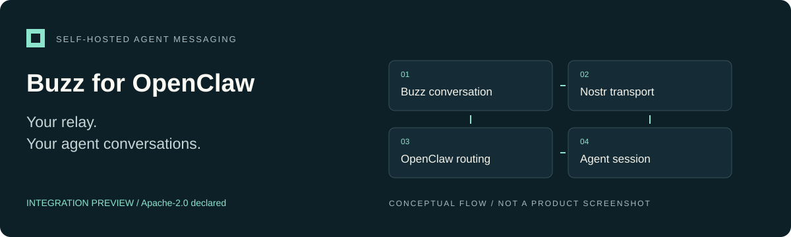

<p align="center"></p>

# Buzz for OpenClaw

**A native OpenClaw channel plugin connecting agent sessions to a self-hosted Buzz relay over Nostr.**

Integration preview · Apache-2.0 · [Project overview](docs/OVERVIEW.md) · [Website](https://alinaos-org.github.io/buzz-openclaw/) · [Landing-page source](docs/site/index.html)

## What it does

Buzz for OpenClaw connects a self-hosted [Buzz](https://github.com/block/buzz) relay to OpenClaw as a native channel plugin. It uses Nostr NIP-01, NIP-42 authentication, and NIP-29 `kind:9` channel messages.

Buzz provides transport. OpenClaw remains responsible for agent routing, model access, workspace policy, and session behavior. **Messages are not end-to-end encrypted.**

## Implemented in the source

- Conversation-based routing through core `resolveAgentRoute`.
- Explicit/project-derived session keys, with a fallback to the core route.
- Sender allowlists, mention gating, thread replies, and sibling-agent suppression.
- Media upload and `imeta` helpers, ephemeral presence, and profile synchronization.
- Multiple account configuration entries with per-account keys and bindings.

These source-level capabilities do not imply current SDK compatibility or a fully qualified multi-account dispatch architecture. Reactions, edits/deletes, and other protocol extensions need separate implementation/qualification.

## Development setup

Use Node.js/npm and an OpenClaw installation that supplies the plugin SDK imports used by this checkout. The supported baseline is OpenClaw 2026.10.3 and Node.js 24.16+ (24.x) or 26.1+. The optional peer range does not guarantee compatibility with every future SDK.

```sh
git clone https://github.com/alinaos-org/buzz-openclaw.git
cd buzz-openclaw
npm ci

# Point this checkout at the exact OpenClaw installation being tested.
ln -s /absolute/path/to/openclaw node_modules/openclaw
npm test
```

Create the peer link only when `node_modules/openclaw` does not already exist. The target must be the package directory containing its `package.json` and exported plugin SDK. No npm registry publication is assumed.

## Configuration sketch

Merge a configuration like this into your gateway's supported configuration source. Replace all illustrative values and retain existing settings.

```json5
{
  channels: {
    buzz: {
      relay: "wss://relay.example.org",
      groupPolicy: "allowlist",
      allowFrom: ["<operator-public-key-hex>"],
      mentionDirectory: { "Operator": "<operator-public-key-hex>" },
      channels: {
        "<conversation-uuid>": { allow: true, project: "example-project" }
      },
      accounts: {
        main: { name: "Assistant", privateKeyEnv: "BUZZ_KEY_MAIN" }
      },
      defaultAccount: "main"
    }
  },
  bindings: [
    { agentId: "main", match: { channel: "buzz", accountId: "main" } }
  ]
}
```

Provide the private key through your deployment's secret mechanism. This sample contains placeholders, not usable credentials or an existing relay. Conversation IDs are canonical and case-sensitive; do not lowercase them.

For development loading, configure `plugins.load.paths`, `plugins.allow`, and `plugins.entries.buzz` according to your installed OpenClaw version. Validate the merged configuration before restarting the gateway. Installing this documentation does not change or restart any service.

## Routing model

Session selection checks an explicit channel `sessionKey`, a declared project slug, the configured projects index, then the route fallback. Thread suffixing is handled separately. Read [session-map.js](src/session-map.js) and the [channel adapter](src/channel.js) for the exact behavior.

Reply-to-bot and explicit mentions can admit a response after sender/channel policy checks. Fleet-authored events are suppressed to avoid reply loops. Replay guards and connection state are in memory; they are not a durable audit ledger.

## Status and security

**Integration preview.** Qualify against the exact gateway build and relay version you intend to run. Local protocol tests do not establish successful production messaging. A trusted self-hosted relay is part of the security boundary; transport encryption is not end-to-end message encryption.

The `scripts/` directory includes operational administration helpers. Review them before use; they are not part of the quick start. Do not run enrollment, key-minting, scripts against a real relay just to test documentation.

Contributions should include a synthetic regression case and `npm test` results, with no private keys, relay transcripts, or personal roster data.

## Verification

All 89 tests pass against the public OpenClaw 2026.10.3 package on Node.js 24.21.0. The suite includes loopback WebSocket/NIP-42 authentication, signed publish/receive, replay suppression, authorization rejection, and failed-admission cleanup. Tests use synthetic identities and mocked runtime dispatch; no production relay or paid model invocation is part of this qualification. Run `npm test` against your exact SDK before deploying.

The source distribution excludes private deployment rosters, relay event captures, and one-off database migration scripts. The included roster is illustrative.

## License

[Apache-2.0](LICENSE). See [NOTICE](NOTICE) for dependency attribution. Buzz is an independent integration, not a Block-endorsed product.
